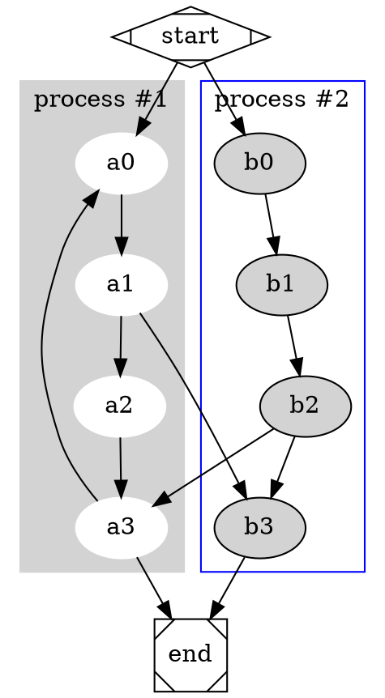

# Nectar

Nectar turns Markdown into a website. `nectar build` writes the site to a directory;
`nectar serve` serves it on your machine and reloads the browser whenever a source file
changes. Every document also gets a print view and a PDF.

## Install

Download the archive for your platform from the
[releases](https://github.com/hivevm/nectar/releases) (tags `nectar-v…`), unpack it and put
`nectar` on your `PATH`. Each release lists the SHA-256 checksums of its archives in
`SHA256SUMS`.

To build from source, install Rust and run:

```sh
cargo install --path crates/cli
```

## Quick start

A project is a directory with a `nectar.toml`:

```toml
title = "My Manual"

[[document]]
source = "content/manual.md"
```

```sh
nectar serve            # http://127.0.0.1:1313/, reloads on every change
nectar build            # writes the site to public/
```

Run either command in the project directory, or name the directory with `-C <dir>`.
`examples/demo` in this repository is a complete project to start from.

| Option | Meaning |
|---|---|
| `-C <dir>` | Project directory, the one that holds `nectar.toml`; default the current one |
| `--offline` | Keep images from the web as links instead of downloading them |
| `build -o <dir>` | Output directory; overrides `output` in `nectar.toml` |
| `build --drafts` | Include files whose front matter says `draft = true` |
| `serve -p <port>`, `serve --bind <addr>` | Address to serve on; default `127.0.0.1:1313` |
| `serve --no-drafts` | Leave out drafts, which `serve` shows by default |

## Common Mark

[Markdown][markdown] is a plain text format for writing structured documents, based on the
conventions of email and Usenet. It does nothing fancy like changing the font size, colour or
type, just the essentials, written with keyboard symbols you already know. A Markdown document
should be readable as it is, as plain text, without looking marked up: its syntax is made of
punctuation chosen to look like what it means. Asterisks around a word look like *emphasis*,
lists look like lists, and block quotes look like quoted passages of an email.

There are many dialects of Markdown. Nectar reads [CommonMark][commonmark], a strongly defined,
highly compatible specification of Markdown; the [CommonMark help](https://commonmark.org/help/)
is a short tour of it. This chapter shows the basic syntax, the next one what Nectar adds. Each
example shows the source first, then how it renders.

[markdown]: https://en.wikipedia.org/wiki/Markdown "Markdown on Wikipedia"
[commonmark]: https://spec.commonmark.org/ "CommonMark Spec"

### Headings

A line that starts with `#` and a space is a heading. The more `#`, the lower the level.

```md
# Manual title
## Chapter
### Section
```

Headings are numbered (`1.`, `1.2.`, …) below the top level; below a skipped level, as with
`####` directly under `##`, numbering continues in Roman numerals. The first page of a document
lists the headings of levels 2 and 3 of the whole document. `numbered = false` and
`contents = false` in the `[[document]]` table turn either off.

!w Write every Markdown file as a document of its own, starting with a top-level heading. When
another file includes it, it becomes a chapter, and its headings move below the heading of the
include ([Documents and chapters](#documents-and-chapters)).

### Paragraphs and line breaks

A paragraph is a run of consecutive lines; one or more blank lines separate paragraphs. A single
line break inside a paragraph is a soft break: the lines run on as one, so a source can be
wrapped for reading without changing the text.

```md
Lorem ipsum dolor sit amet, consetetur sadipscing elitr,
sed diam nonumy eirmod tempor.
```

Lorem ipsum dolor sit amet, consetetur sadipscing elitr,
sed diam nonumy eirmod tempor.

A backslash `\` or two spaces at the end of a line make a hard break: the text continues on a
new line.

```md
Lorem ipsum dolor sit amet, consetetur sadipscing elitr,\
sed diam nonumy eirmod tempor.
```

Lorem ipsum dolor sit amet, consetetur sadipscing elitr,\
sed diam nonumy eirmod tempor.

### Page breaks

Three or more `-`, `_` or `*` on a line of their own form a thematic break. On the website it is
a horizontal rule; in the print view and the PDF it starts a new page.

```md
End of the part.

___

Start of the next part.
```

### Blockquotes

A line that starts with `>` and an optional space is a block quote. Block quotes nest and may
hold any other formatting.

```md
> First line
> Another line
>
> > Nested line
>
> Last line
```

> First line
> Another line
>
> > Nested line
>
> Last line

### Emphasis

One `*` or `_` on each side makes *italic*, two make **bold**, three ***bold and italic***. A
backslash in front, `\*` or `\_`, writes the character itself. Nectar adds ____underline____
with four underscores, ~~strikethrough~~ with two tildes and //highlight// with two slashes.

```md
*italic* _italic_
**bold** __bold__
***bold and italic***
____underline____
~~strikethrough~~
//highlight//
```

### Lists

An unordered list uses `-`, `*` or `+` as marker; an ordered list uses numbers followed by `.`
or `)`. Lists nest when an item is indented below the text of its parent, and ordered and
unordered lists mix.

```md
1. Fruit
   - Apple
   - Pear
2. Vegetable
   - Potato
   - Carrot
```

1. Fruit
   - Apple
   - Pear
2. Vegetable
   - Potato
   - Carrot

An item that starts with `[ ]` or `[x]` is a task.

```md
- [x] Release candidate
- [ ] Product release
```

- [x] Release candidate
- [ ] Product release

### Links

A link is its text in square brackets followed by the target in parentheses. A bare URL such as
https://commonmark.org becomes a link by itself.

```md
[CommonMark](https://commonmark.org)
```

A reference link names its target by an identifier, defined anywhere in the same file. Without
a text, `[][id]` shows only the footnote of the link.

```md
See [the specification][spec] or [][spec].

[spec]: https://spec.commonmark.org/ "CommonMark Spec"
```

See [the specification][spec] or [][spec].

[spec]: https://spec.commonmark.org/ "CommonMark Spec"

A reference link to an external target gets a footnote that shows the title and the URL, so the
target survives on paper; links to the same URL in one file share it. Links within the
documentation are described in [Internal links](#internal-links).

### Images

An image is written like a link with a `!` in front; the text in brackets describes the image.

```md


{width=4cm align=center}
```

Attributes in braces right after the image set its size and alignment. `width` and `height` take
a bare number in pixels or a length such as `50%` or `4cm`; `align` takes `left`, `center` or
`right`, and `left` and `right` let the text flow around the image.

Images are part of the documentation wherever they come from. Local images are copied into
the output; images from the web (`https://…`) and `data:` URIs are downloaded or decoded during
the build, stored in `<document>/_remote/` and served from there, and the PDF embeds them all.
A download takes at most 30 seconds, 20 MB and five redirects, must be an image, and happens
once per `nectar serve` session. An image that cannot be fetched keeps its link and is reported.
`--offline` keeps images from the web as links.

### Code

Backticks around text make `inline code`. A code block is indented by four spaces, or fenced
by three backticks or three tildes on a line above and below it. The word after the opening
fence picks the language ([Code and diagrams](#code-and-diagrams)).

````md
```ini
[owner]
name = John Doe
```
````

```ini
; last modified 1 April 2001 by John Doe
[owner]
name = John Doe
organization = Acme Widgets Inc.
```

## Extended syntax

Nectar builds on CommonMark with the features of this chapter. Some of them read plain CommonMark
differently; [Differs from CommonMark](#differs-from-commonmark) lists those.

### Documents and chapters

Documentation can be spread over many files. Every `[[document]]` in `nectar.toml` names a start
document. A link that stands alone on its line includes another Markdown file as a chapter;
consecutive lines of such links include one file each:

```md
# Manual

[Installation](parts/install.md)

## [Appendix](parts/appendix.md)
```

- Headings of the included file move below the heading the include follows, or below the
  heading marker written in front of the link.
- The link text replaces the first top-level heading of the included file.
- Relative links, images and further includes in the included file resolve against its own
  directory.
- Footnote definitions belong to their file; footnotes are numbered across the whole document.

A link is an include only when its target ends in `.md` and the file exists. An include cycle is
an error.

With `split = "chapter"` (the default) every chapter becomes a page of its own, with breadcrumbs
and previous/next links. The menu shows the chapters as a tree whose branches open and close;
the branches along the current page are open, and the menu remembers the branches you opened
while the browser tab stays open. With `split = "none"` the whole document is one
page and the menu tree lists its headings.

### Front matter

A file may start with TOML between `+++` lines. All fields are optional; a file without front
matter behaves exactly as one with an empty block.

```md
+++
title = "Installation"    # page title, instead of the first heading
slug  = "install"         # path segment of the page when the document is split
draft = true              # left out by `nectar build`, shown by `nectar serve`
[vars]
version = "1.2.0"
+++
```

### Comments

A link reference definition is never shown itself; one with the target `#` and the text in
parentheses serves as a comment.

```md
[comment]: # (This line is not shown.)
```

[comment]: # (This line is not shown.)

### Internal links

A link to a heading of the documentation takes its id as target, `#` in front:

- the id given in braces after the heading, `## Installation {#install}`;
- the slug of the heading, its text in lower case with spaces turned into `-`;
- the heading text itself, spaces included, which Nectar turns into the slug;
- `other.md#heading` for a heading of another file.

```md
[Lists](#lists), [Page breaks](#page-breaks), [Images](#images)
```

[Lists](#lists), [Page breaks](#page-breaks), [Images](#images)

The target `#Page breaks`, the heading text, links to the same heading as `#page-breaks`.
Headings without special characters keep their links simple.

### Tables

A table is a header row, a delimiter row of three or more `-` for each column, and the body rows,
the cells separated by `|`; the pipes at both ends are optional. A colon in the delimiter row
aligns the column: `:---` left, `:---:` centred, `---:` right.

```md
| Auto | Centre | Left  | Right       |
|------|:------:|:------|------------:|
| Auto | Centre | Left  | Right       |
```

| Auto | Centre | Left  | Right       |
|------|:------:|:------|------------:|
| Auto | Centre | Left  | Right       |

- The number of `-` in each cell of the delimiter row sets the column's relative width, here
  6 : 8 : 7 : 13. The PDF keeps the ratio exactly; on the website it is a preference, no column
  gets narrower than its longest word, and a table too wide for the page scrolls sideways. When
  the delimiter row has fewer or more cells than the table has columns, all columns are equal.
- In the print view the header row repeats on every page the table runs across.
- A cell holds inline content: emphasis, code, links, images, footnotes, symbols, variables. It
  holds no paragraphs, lists or code blocks, and cells cannot span rows or columns.
- A table may stand in a block quote or an alert.

### Alerts

An alert is a block quote coloured by its kind. A line that starts with `!` and
a letter for the kind opens one: `n` note, `s` success, `w` warning, `e` error.

```md
!n Note
```

!n Note

```md
!s Success
```

!s Success

```md
!w Warning
```

!w Warning

```md
!e Error
```

!e Error

An alert of several paragraphs starts with `!!` and the letter, and ends with a line of `!!`.

```md
!!w Lorem ipsum dolor sit amet, consetetur sadipscing elitr.

Sed diam nonumy eirmod tempor invidunt ut labore et dolore magna aliquyam erat.
!!
```

!!w Lorem ipsum dolor sit amet, consetetur sadipscing elitr.

Sed diam nonumy eirmod tempor invidunt ut labore et dolore magna aliquyam erat.
!!

GitHub's notation `> [!NOTE]`, `> [!TIP]`, `> [!IMPORTANT]`, `> [!WARNING]` and `> [!CAUTION]`
gives alerts as well.

### Footnotes

A footnote is written as `text[^id]` with a definition `[^id]: The footnote.` anywhere in the
same file.

```md
Nectar reads CommonMark.[^dialect]

[^dialect]: With the additions of this chapter.
```

Nectar reads CommonMark.[^dialect]

[^dialect]: With the additions of this chapter.

Labels belong to their file, so two chapters may both use `[^1]`; the numbers run through the
whole document in reading order. The website lists the footnotes of a page at its end, the
reference linking to them. The print view and the PDF put each footnote at the foot of the page
it is referenced on.

### Symbols

A name between two `@` is a symbol of the [Material Icons](https://fonts.google.com/icons) font.

```md
@web@ @smartphone@ @settings@ @link@
```

@web@ @smartphone@ @settings@ @link@

### Variables

`{{name}}` is replaced by the value of the variable `name`; this guide is built with
`version` set to {{version}}. Values come from `[vars]` in `nectar.toml`, environment variables
`NECTAR_<name>` or the front matter, each overriding the one before. `{{name;format}}` is
accepted, the format ignored. A known name is replaced in code as well. An unknown name stays as
written and is reported, unless it stands in code.

### Raw HTML

Raw HTML, such as `<file>` written in a sentence, is shown as text and reported, so nothing in
a source disappears into the page as markup. `html = true` in `nectar.toml` passes it to the
website instead; the PDF still leaves it out and reports it.

### Differs from CommonMark

Some plain CommonMark reads differently in Nectar:

- A link that stands alone on its line and points to a `.md` file includes that file as a
  chapter ([Documents and chapters](#documents-and-chapters)).
- An image that stands alone in its paragraph and points to a file that is not a picture embeds
  that file as code ([Embedded files](#embedded-files)).
- A thematic break (`---`, `___`, `***`) starts a new page in the print view and the PDF.
- Raw HTML is shown as text unless `html = true`.
- A reference link to an external target gets a footnote with its title and URL.
- `____text____` underlines instead of nesting strong emphasis.
- A line that starts with `!n`, `!s`, `!w`, `!e` or `!!` opens an alert instead of a paragraph.
- `//text//`, `@name@` and `{{name}}` are read as highlight, symbol and variable.
- A link target `#Heading text` with spaces is a link to that heading.

## Code and diagrams

The info string of a fenced code block picks an engine:

- Every language with a TextMate grammar is highlighted, from `rust` and `java` to `yaml` and
  `sql`.
- `railroad` draws railroad diagrams from (E)BNF.
- `dot`, `uml`, `ebnf`, `regex` and `jsongraph` are drawn by Graphviz and PlantUML, once they
  are configured ([Engines](#engines)).

### Highlighted code

```yaml
# An employee record
name: Martin D'vloper
job: Developer
skill: Elite
employed: True
foods:
  - Apple
  - Orange
languages:
  perl: Elite
  python: Elite
  pascal: Lame
education: |
  4 GCSEs
  3 A-Levels
  BSc in the Internet of Things
```

```java
import java.awt.Rectangle;

public class ObjectVarsAsParameters {
    public static void main(String[] args) {
        Rectangle r1 = new Rectangle(0, 0, 5, 5);
        r1.setSize(10, 15);
        System.out.println("r1 " + r1);
    }
}
```

```rust
// Function that returns a boolean value
fn is_divisible_by(lhs: u32, rhs: u32) -> bool {
    // Corner case, early return
    if rhs == 0 {
        return false;
    }
    // This is an expression, the `return` keyword is not necessary here
    lhs % rhs == 0
}
```

### Railroad diagrams

A `railroad` block draws a railroad diagram, also called a syntax diagram, for every rule of a
grammar in (E)BNF, each under its name.

```railroad
H2_SELECT =
    'SELECT' [ 'TOP' term ] [ 'DISTINCT' | 'ALL' ] selectExpression {',' selectExpression} \
    'FROM' tableExpression {',' tableExpression} [ 'WHERE' expression ] \
    [ 'GROUP BY' expression {',' expression} ] [ 'HAVING' expression ] \
    [ ( 'UNION' [ 'ALL' ] | 'MINUS' | 'EXCEPT' | 'INTERSECT' ) select ] [ 'ORDER BY' order {',' order} ] \
    [ 'LIMIT' expression [ 'OFFSET' expression ] [ 'SAMPLE_SIZE' rowCountInt ] ] \
    [ 'FOR UPDATE' ];
```

The notation:

| Construct | Write |
|---|---|
| Definition | `rule = …`, `rule := …` or `rule ::= …` |
| Termination | `;` at the end of a rule |
| Sequence | `a b` or `a, b` |
| Choice | `a \| b` |
| Option | `[ a ]` or `a?` |
| Repetition, none or more | `{ a }` or `a*` |
| Repetition, once or more | `a+` |
| Exactly n times | `n * a` |
| At most n times | `n * [ a ]` or `n * a?` |
| Group | `( … )` |
| Literal | `"…"` or `'…'` |
| Special sequence | `(? … ?)` |
| Comment | `(* … *)` |
| Line break | `\` continues the rule on a new line of the diagram |

A loop is labelled with the number of passes, such as `3×` for `3 * a`, `1..3×` or `≥2×`;
"once or more" has no label.

### Graphviz and PlantUML

With the [engines](#engines) configured, `dot` blocks go to Graphviz and `uml`, `ebnf`,
`regex` and `jsongraph` blocks to PlantUML.

```uml
hide footbox
actor Caller
participant "Task1" as T1
participant "Task2" as T2
participant REST

Caller -> T1 : execute()
activate T1
T1 -> REST : GET
T1 -> T2 : execute()
deactivate T1
activate T2
T2 -> REST : GET
Caller <-- T2 : return
deactivate T2
```

```uml
start
repeat
  :Test something;
  if (Something went wrong?) then (no)
    #palegreen:OK;
    break
  endif
  ->NOK;
  :Alert "Error";
repeat while (Something went wrong?) is (yes) not (no)
:Alert "Success";
stop
```



```ebnf
title LISP Grammar
s_expression = atomic_symbol | "(", s_expression, ".", s_expression, ")" | list;
list = "(", s_expression, { s_expression }, ")";
atomic_symbol = letter, atom_part;
atom_part = empty | letter, atom_part | number, atom_part;
letter = ? a-z ?;
number = ? 1-9 ?;
empty = " ";
```

```regex
!option useDescriptiveNames false

\\d?\\D+\\w*\\W{1,2}|\\s.\\S
```

```jsongraph
#highlight "lastName"
#highlight "address" / "city"
{
  "firstName": "John",
  "lastName": "Smith",
  "age": 27,
  "address": { "streetAddress": "21 2nd Street", "city": "New York" },
  "phoneNumbers": [
    { "type": "home", "number": "212 555-1234" },
    { "type": "office", "number": "646 555-4567" }
  ]
}
```

### Embedded files

An image that stands alone in its paragraph and points to a file that is not a picture embeds
that file instead, with the image text as caption:

```md


```

The file extension picks the engine: `.java` is highlighted as Java, `.rs` as Rust,
`.railroad` is drawn, `.dot` and `.puml` go to Graphviz and PlantUML; any other extension is
taken as the language. Without an image text the file is embedded without a caption. An
embedded file is a source of the build, so `nectar serve` rebuilds when it changes.

### Engines

```toml
[engine.textmate]
enabled    = true                 # on by default
theme      = "github-light"       # any of the ~60 bundled themes
dark_theme = "github-dark"        # for a dark colour scheme; "" turns it off

[engine.railroad]
enabled = true                    # on by default

[engine.process.dot]
command   = "dot"
args      = ["-Tsvg"]
languages = ["dot"]

[engine.process.plantuml]
command   = "plantuml"
args      = ["-tsvg", "-pipe"]
languages = { uml = "uml", ebnf = "ebnf", regex = "regex", jsongraph = "json" }
input     = "@start{lang}\n!pragma layout smetana\n{code}\n@end{lang}"
timeout   = 30
```

Process engines are asked first, then railroad, then TextMate; a language no engine takes stays
plain code. A process engine passes the code, or the code filled into `input`, on standard input
and expects SVG on standard output. When a command is missing, exits non-zero, writes no `<svg`
element or runs longer than `timeout` seconds, the block stays plain code and Nectar reports a
warning.

## Configuration

| Key | Meaning |
|---|---|
| `title` | Site title |
| `output` | Output directory of `nectar build`, default `public` |
| `theme` | Theme directory below `themes/`; the built-in theme otherwise |
| `[[document]] source` | Start document |
| `[[document]] path` | Output directory of the document; the root for a single document |
| `[[document]] split` | `"chapter"` or `"none"` |
| `[[document]] numbered` | Section numbers, default `true` |
| `[[document]] contents` | Contents of the whole document on its first page, default `true` |
| `[vars]` | Values for `{{name}}` |
| `html` | `true` passes raw HTML to the website; default `false`, which shows it as text |
| `[engine.…]` | Code engines, see [Engines](#engines) |
| `[serve] port`, `bind` | Address of `nectar serve`, default `127.0.0.1:1313` |
| `[document.print]` | Print view and PDF, see [Print view and PDF](#print-view-and-pdf) |

## Output

`nectar build` writes, and `nectar serve` serves:

```
public/
  index.html                 site index, when every document has a directory of its own
  <document>/index.html      root chapter
  <document>/<slug>/index.html
  <document>/<asset path>    local images and files, relative to the start document
  <document>/_remote/        images from the web
  <document>/print/          print view and PDF
  _graphics/<hash>.svg       diagrams, named by their content
  _theme/                    the theme's static files
```

Links between the files are relative, so the output also works when opened from disk.

## Print view and PDF

Besides the website, every document gets two outputs for print, both next to each other in
`<document>/print/`:

- the print view `index.html`: the whole document in one file, laid out into pages in the
  browser; the print icon at the top of every web page opens it;
- the PDF file `<start document>.pdf`, typeset with [Typst](https://typst.app); the PDF icon
  opens it.

The print view shows the pages on screen as they will print; printing it, or saving it as
PDF from the browser's print dialog, gives exactly these pages.

Both have a cover, the contents with page numbers, running headers with the document and
chapter title, page numbers and footnotes at the foot of the page. Both stay light when the
website is dark. They share their settings per document:

```toml
[document.print]
enabled       = true          # false: no print view for this document
pdf           = true          # false: no PDF for this document
size          = "A4"          # A3–A6, B4, B5, letter, legal, "A5 landscape" or two lengths
margin        = "20mm 18mm"   # one to four lengths in mm, cm, in or pt, as in CSS
cover         = true          # cover page with site and document title
subtitle      = "Version 1.2" # on the cover
cover_image   = "img/logo.png"
chapter_pages = false         # each chapter starts with a page showing its number
watermark     = "draft"       # "draft", "confidential" or an image of the project
```

The pages are laid out by [Paged.js](https://pagedjs.org), which the built-in theme bundles.

## Colour scheme

The website follows the system's light or dark colour scheme, highlighted code included
(`theme` and `dark_theme` of `[engine.textmate]`). A switch in the top bar steps through system,
light and dark and keeps the choice for the site; it shows only where scripts run.

## Themes

A theme is a directory `themes/<name>/` with the [minijinja](https://docs.rs/minijinja)
templates `layouts/page.html` for the website and `layouts/print.html` for the print view, and
`static/`, whose files are copied to `_theme/` in the output. A project theme overrides the
built-in theme file by file.

## Diagnostics

Problems are reported with file and line. `nectar build` fails on errors and lists warnings;
`nectar serve` also shows them in a panel on every page and keeps watching. Raw HTML shown as text
is reported, and the PDF reports what it leaves out: raw HTML where `html = true`, and images it
could not embed.

## Editor

`.vscode/launch.json` starts `nectar serve` or `nectar build` under the debugger and opens the
site in the browser.
