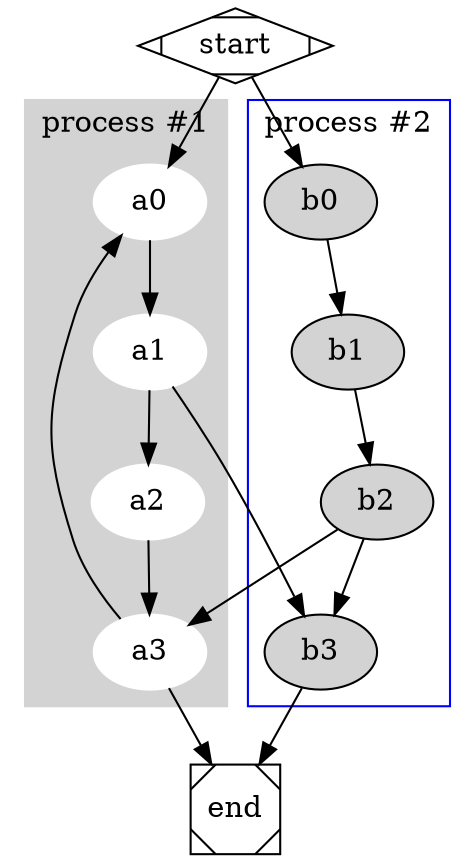

# Code and diagrams

The info string of a fenced code block picks an engine:

- Every language with a TextMate grammar is highlighted, from `rust` and `java` to `yaml` and
  `sql`.
- `railroad` draws railroad diagrams from (E)BNF.
- `dot`, `uml`, `ebnf`, `regex` and `jsongraph` are drawn by Graphviz and PlantUML, once they
  are configured ([Engines](#engines)).

## Highlighted code

```yaml
# An employee record
name: Martin D'vloper
job: Developer
skill: Elite
employed: True
foods:
  - Apple
  - Orange
languages:
  perl: Elite
  python: Elite
  pascal: Lame
education: |
  4 GCSEs
  3 A-Levels
  BSc in the Internet of Things
```

```java
import java.awt.Rectangle;

public class ObjectVarsAsParameters {
    public static void main(String[] args) {
        Rectangle r1 = new Rectangle(0, 0, 5, 5);
        r1.setSize(10, 15);
        System.out.println("r1 " + r1);
    }
}
```

```rust
// Function that returns a boolean value
fn is_divisible_by(lhs: u32, rhs: u32) -> bool {
    // Corner case, early return
    if rhs == 0 {
        return false;
    }
    // This is an expression, the `return` keyword is not necessary here
    lhs % rhs == 0
}
```

## Railroad diagrams

A `railroad` block draws a railroad diagram, also called a syntax diagram, for every rule of a
grammar in (E)BNF, each under its name.

```railroad
H2_SELECT =
    'SELECT' [ 'TOP' term ] [ 'DISTINCT' | 'ALL' ] selectExpression {',' selectExpression} \
    'FROM' tableExpression {',' tableExpression} [ 'WHERE' expression ] \
    [ 'GROUP BY' expression {',' expression} ] [ 'HAVING' expression ] \
    [ ( 'UNION' [ 'ALL' ] | 'MINUS' | 'EXCEPT' | 'INTERSECT' ) select ] [ 'ORDER BY' order {',' order} ] \
    [ 'LIMIT' expression [ 'OFFSET' expression ] [ 'SAMPLE_SIZE' rowCountInt ] ] \
    [ 'FOR UPDATE' ];
```

The notation:

| Construct | Write |
|---|---|
| Definition | `rule = …`, `rule := …` or `rule ::= …` |
| Termination | `;` at the end of a rule |
| Sequence | `a b` or `a, b` |
| Choice | `a \| b` |
| Option | `[ a ]` or `a?` |
| Repetition, none or more | `{ a }` or `a*` |
| Repetition, once or more | `a+` |
| Exactly n times | `n * a` |
| At most n times | `n * [ a ]` or `n * a?` |
| Group | `( … )` |
| Literal | `"…"` or `'…'` |
| Special sequence | `(? … ?)` |
| Comment | `(* … *)` |
| Line break | `\` continues the rule on a new line of the diagram |

A loop is labelled with the number of passes, such as `3×` for `3 * a`, `1..3×` or `≥2×`;
"once or more" has no label.

## Graphviz and PlantUML

With the [engines](#engines) configured, `dot` blocks go to Graphviz and `uml`, `ebnf`,
`regex` and `jsongraph` blocks to PlantUML.

```uml
hide footbox
actor Caller
participant "Task1" as T1
participant "Task2" as T2
participant REST

Caller -> T1 : execute()
activate T1
T1 -> REST : GET
T1 -> T2 : execute()
deactivate T1
activate T2
T2 -> REST : GET
Caller <-- T2 : return
deactivate T2
```

```uml
start
repeat
  :Test something;
  if (Something went wrong?) then (no)
    #palegreen:OK;
    break
  endif
  ->NOK;
  :Alert "Error";
repeat while (Something went wrong?) is (yes) not (no)
:Alert "Success";
stop
```



```ebnf
title LISP Grammar
s_expression = atomic_symbol | "(", s_expression, ".", s_expression, ")" | list;
list = "(", s_expression, { s_expression }, ")";
atomic_symbol = letter, atom_part;
atom_part = empty | letter, atom_part | number, atom_part;
letter = ? a-z ?;
number = ? 1-9 ?;
empty = " ";
```

```regex
!option useDescriptiveNames false

\\d?\\D+\\w*\\W{1,2}|\\s.\\S
```

```jsongraph
#highlight "lastName"
#highlight "address" / "city"
{
  "firstName": "John",
  "lastName": "Smith",
  "age": 27,
  "address": { "streetAddress": "21 2nd Street", "city": "New York" },
  "phoneNumbers": [
    { "type": "home", "number": "212 555-1234" },
    { "type": "office", "number": "646 555-4567" }
  ]
}
```

## Embedded files

An image that stands alone in its paragraph and points to a file that is not a picture embeds
that file instead, with the image text as caption:

```md


```


The file extension picks the engine: `.java` is highlighted as Java, `.rs` as Rust,
`.railroad` is drawn, `.dot` and `.puml` go to Graphviz and PlantUML; any other extension is
taken as the language. Without an image text the file is embedded without a caption. An
embedded file is a source of the build, so `nectar serve` rebuilds when it changes.

## Engines

```toml
[engine.textmate]
enabled    = true                 # on by default
theme      = "github-light"       # any of the ~60 bundled themes
dark_theme = "github-dark"        # for a dark colour scheme; "" turns it off

[engine.railroad]
enabled = true                    # on by default

[engine.process.dot]
command   = "dot"
args      = ["-Tsvg"]
languages = ["dot"]

[engine.process.plantuml]
command   = "plantuml"
args      = ["-tsvg", "-pipe"]
languages = { uml = "uml", ebnf = "ebnf", regex = "regex", jsongraph = "json" }
input     = "@start{lang}\n!pragma layout smetana\n{code}\n@end{lang}"
timeout   = 30
```

Process engines are asked first, then railroad, then TextMate; a language no engine takes stays
plain code. A process engine passes the code, or the code filled into `input`, on standard input
and expects SVG on standard output. When a command is missing, exits non-zero, writes no `<svg`
element or runs longer than `timeout` seconds, the block stays plain code and Nectar reports a
warning.

## On the command line

`nectar render` runs the engine of one language on one text, without a document. It reads the
file it is given, or standard input, and writes to the file `-o` names, or to standard output:

```sh
echo 'rule ::= "a" | "b" ;' | nectar render railroad > rule.svg
nectar render railroad grammar.txt -o grammar.png
nectar render rust main.rs -f ansi            # coloured in the terminal
nectar -C docs render dot graph.gv -o graph.svg
```

| Output of the engine | Formats (`-f`) | Default |
|----------------------|----------------|---------|
| a diagram            | `svg`, `png`   | `svg`   |
| highlighted code     | `html`, `ansi` | `html`  |

Without `-f`, the extension of `-o` picks the format; an extension of the other kind, such as
`-o main.png` for highlighted code, is an error, and one that names no format gives the
default. `html` is a `<pre>` with inline styles in the colours of `theme`; `ansi` is
24-bit colour for a terminal. A PNG has the size of the SVG, and its text is set in the fonts
the PDF uses; like the SVG, it has a transparent background, so dark lines on a dark page are
hard to see.

Without `-C`, railroad and the TextMate grammars run with their defaults, and no `nectar.toml`
is read. With `-C <dir>`, the `[engine]` table of that directory's `nectar.toml` configures
them, process engines included; the file has to be a complete project configuration, with at
least one `[[document]]`. The file to read and the file `-o` names stay relative to the
current directory, not to `<dir>`: `nectar -C docs render dot graph.gv` reads `./graph.gv`.
A language no engine takes, a format the output does not have,
or an engine that fails is an error, and nothing is written.
